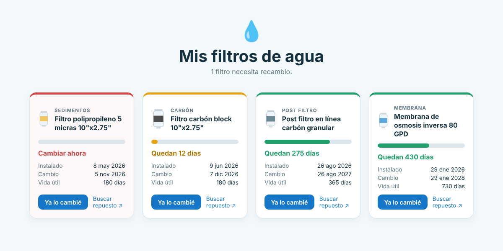

# 💧 Filter Project — Backend

REST API that stores the replacement cycle of each cartridge in a home water filter system.
It works with the **[filter-project](https://github.com/patcont/filter-project)** React frontend.



## Tech

Node.js 22 · Express 5 · built-in `node:sqlite` (no native modules to compile) · `node:test`

## Run it locally

```bash
cp .env.example .env   # optional: PORT, DB_PATH, CORS_ORIGIN
npm install
npm start              # http://localhost:5000
npm test
```

The database is created automatically in `data/filters.db` and seeded with a 4-stage system.
Default lifespans (sediment 180 d, carbon block 180 d, post filter 365 d, RO membrane 730 d) are only
starting points: change them to what your filter brand recommends.

## API

| Method | Route | Description |
| --- | --- | --- |
| `GET` | `/health` | Health check |
| `GET` | `/filters` | All filters with computed `due_date`, `days_left`, `expired` |
| `GET` | `/filters/:id` | One filter |
| `PATCH` | `/filters/:id` | Body: `{ "restart": true }`, `{ "date": "2026-11-01" }` and/or `{ "lifespan_days": 90 }` |

Example:

```bash
curl -X PATCH localhost:5000/filters/1 \
  -H "Content-Type: application/json" \
  -d '{"restart": true}'
```

## 2026 rebuild

- `node_modules/` (~1,500 files) and the SQLite database are no longer committed
- `sqlite3` native module replaced with Node's built-in `node:sqlite`; Express 4 → 5, ES modules
- Fixed startup error when the table already existed; seed data now matches the frontend
- Each filter has its own `lifespan_days`; status is computed on the server
- Input validation, 404/400 handling, configurable CORS, graceful shutdown and tests

The original version is preserved in the git history.
